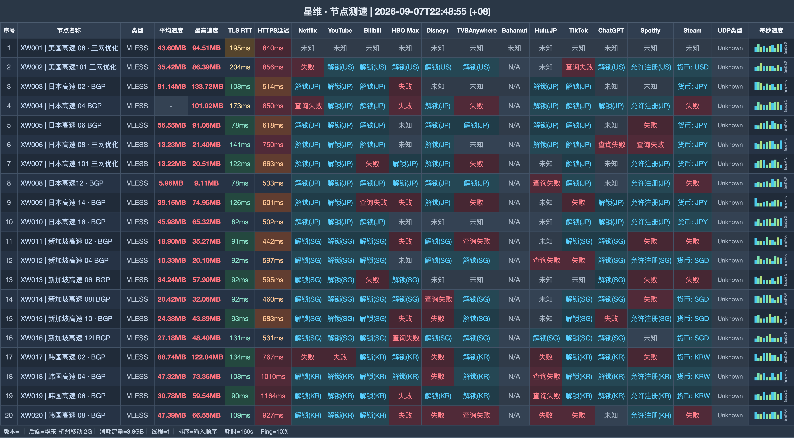

# 星维机场｜8 元/月 160G，年付 80 元每月 240G（2026-11-07 更新）

> **一句话评价：低价长期之选：8 元月付先试，80 元年付把月均成本压到 6.7 元**
>
> 👉 **[官网注册](https://xinweicloud.com/?mode=register&invite=ICg5rb7n)** · 先用 8 元月付；确定长期使用后选 80 元年付更划算。

**适合：**

- 预算有限，想从 8 元低成本开始
- 确定长期使用，愿意年付省钱
- 流量不规律，想买永不过期流量包

**不适合：**

- 换套餐时不想重置流量
- 需要设备数和限速写得很明确

| | |
|---|---|
| 月付起步 | 8 元 / 160G |
| 年付推荐 | 80 元 / 每月 240G |
| 折合月价 | 约 6.67 元 |
| 大流量月付 | 38 元 / 1000G |
| 不限时包 | 20 元 / 200G 起 |
| 协议 |  VLESS |

**关于星维**：星维（xinwei）月付 8 元/160G 起，年付 80 元折合月均 6.7 元，不限时包可叠加。

## 套餐

| 套餐 | 价格 | 流量 | 设备 | 限速 | 说明 |
|---|---:|---:|---:|---:|---|
| 年付每月240G | ¥80/年付 | 240G · 每月 | — | — | 标题10+2；有效期明确365天 |
| 月付每月160G | ¥8/月付 | 160G · 每月 | — | — | — |
| 季付每月160G | ¥20/季付 | 160G · 每月 | — | — | — |
| 半年付每月160G | ¥40/半年付 | 160G · 每月 | — | — | — |
| 月付增强版每月300G | ¥15/月付 | 300G · 每月 | — | — | — |
| 季付增强版每月300G | ¥42/季付 | 300G · 每月 | — | — | — |
| 半年付增强版每月300G | ¥80/半年付 | 300G · 每月 | — | — | — |
| 月付超级增强版每月500G | ¥21/月付 | 500G · 每月 | — | — | — |
| 月付至尊增强版每月1000G | ¥38/月付 | 1000G · 每月 | — | — | — |
| 不限时200G | ¥20/一次性 | 200G · 用完为止 | — | — | 多次购买可叠加 |
| 不限时500G | ¥45/一次性 | 500G · 用完为止 | — | — | 多次购买可叠加 |

> 续相同套餐不会重置流量；换套餐会折抵剩余价值并重置。测速数据测试端为华东-杭州移动。

## 测速参考

共 20 个节点（下载/延迟），测试端 华东-杭州移动 2G，完整记录见下图与 `data/`。

## 怎么选

- 第一次用可看 8 元 160G，先确认设备、限速和特殊商品退款规则。
- 确定长期使用后再比较 80 元年付：有效期明确 365 天，每月 240G，不能把“10+2”另解读为额外月份。
- 偶尔使用可比较 20 元 200G 永不过期包，多次购买可叠加。

## 注册

👉 **[官网注册](https://xinweicloud.com/?mode=register&invite=ICg5rb7n)** · 先用 8 元月付；确定长期使用后选 80 元年付更划算。

*本文使用推广链接，注册或购买后本站可能获得佣金。*

## 更新

- **2026-11-07** — 每日复核：套餐、价格与公告无变化；多账号发布对齐核查完成。
- **2026-11-06** — 每日复核：套餐、价格与公告无变化；多账号发布对齐核查完成。
- **2026-11-05** — 每日复核：套餐、价格与公告无变化；多账号发布对齐核查完成。
- **2026-11-04** — 每日复核：套餐、价格与公告无变化；多账号发布对齐核查完成。
- **2026-11-02** — 每日复核：套餐、价格与公告无变化；多账号发布对齐核查完成。
- **2026-10-31** — 整理当前套餐资料，共 11 个套餐/展示项；加入节点测速参考。
- **2026-09-08** — 节点测速记录日期。

---
*价格、节点和活动会变化，下单时以套餐页显示为准。*

---

相关搜索：星维 / xinwei / 机场推荐

本文关键词：星维、xinwei、星维机场、xinweicloud、星维cloud、机场推荐、机场测评、机场推荐2026、科学上网、代理、VPN、clash 订阅、星维官网、星维注册、星维测速

